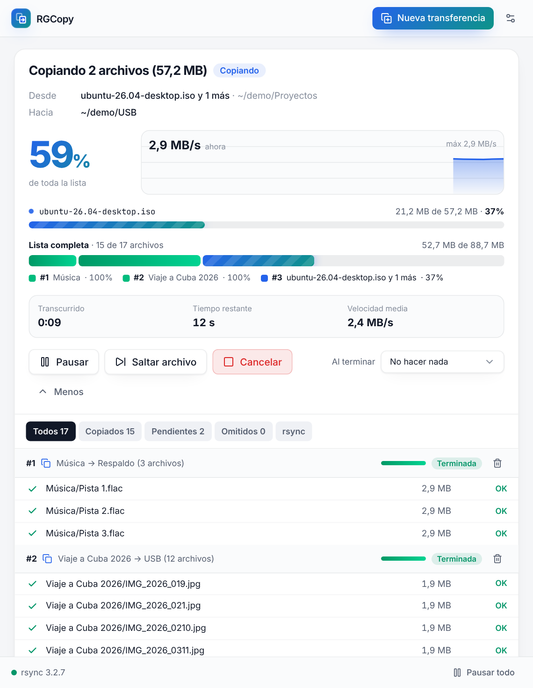
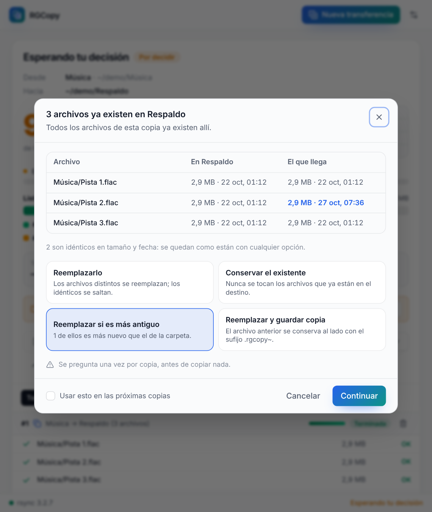
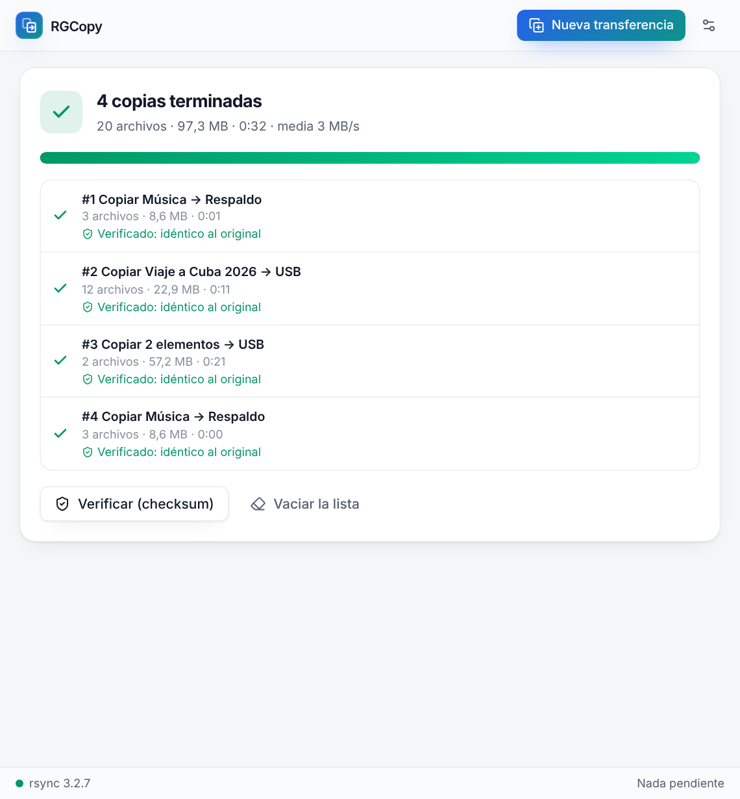

<p align="center">
  
</p>

<h1 align="center">RGCopy</h1>

<p align="center">
  Copias y movimientos de archivos para Linux con rsync: Ctrl+C, Ctrl+V y una cola que no se rompe.<br>
  <em>A file copy queue for Linux powered by rsync, in Spanish and English.</em>
</p>



RGCopy toma el Ctrl+V de tu gestor de archivos, como TeraCopy en Windows: copias o cortas en Nautilus, Nemo o Caja, pegas, y la copia la hace RGCopy con rsync. Puedes pausarla y reanudarla, ver la velocidad y el tiempo restante, saltar un archivo, y volver a lanzar una copia interrumpida para que termine solo lo que falta. Cada nuevo Ctrl+V se suma a la misma ventana.

## Historia

RGCopy nació en 2014 de la mano de **Reinier Reisy Quevedo Batista**, como una interfaz GTK (Glade) para rsync que se lanzaba desde un script de Nautilus. Leía el portapapeles del gestor de archivos, incluidos los recursos SMB y SFTP montados con GVfs, mostraba la lista de archivos con su estado y permitía pausar la copia. Andy Torres contribuyó la versión independiente en 2017.

Sus piezas envejecieron (Python 2, Unity, AppIndicator). **RGCopy 2** es una reconstrucción que conserva la idea: rsync como motor, el portapapeles del gestor de archivos y la lista de archivos, sobre una base moderna. La aplicación original se conserva, sin cambios, en [`legacy/`](legacy/).

## Instalación

### Paquetes para Linux

Descarga el paquete de tu distribución desde la [página de releases](https://github.com/lam1623/RGCopy/releases). Los paquetes traen su propio Python y Qt; tu gestor de paquetes instala rsync y las bibliotecas de escritorio habituales.

| Distribución | Paquete | Se instala con |
| --- | --- | --- |
| Ubuntu 22.04+, Debian 12+, Linux Mint 21+, Pop!_OS 22.04+ | `rgcopy_2.0.0-1_amd64.deb` | `sudo apt install ./rgcopy_2.0.0-1_amd64.deb` |
| Fedora, openSUSE Tumbleweed | `rgcopy-2.0.0-1.x86_64.rpm` | `sudo dnf install ./rgcopy-2.0.0-1.x86_64.rpm` o `sudo zypper install --allow-unsigned-rpm ./rgcopy-2.0.0-1.x86_64.rpm` |
| Arch, Manjaro, EndeavourOS | `rgcopy-2.0.0-1-x86_64.pkg.tar.zst` | `sudo pacman -U ./rgcopy-2.0.0-1-x86_64.pkg.tar.zst` |
| Cualquier otra con glibc 2.35+ | `rgcopy-2.0.0-linux-x86_64.tar.gz` | descomprímelo y ejecuta `./rgcopy`, o `./install.sh` para añadirlo al menú |

Después ejecuta **una vez, con tu usuario**, `rgcopy integrate`: así Ctrl+V en Nautilus, Nemo y Caja pega con RGCopy (ver abajo). Dolphin ya tiene «Pegar con RGCopy» en su menú desde la instalación.

Antes de publicar una versión, cada paquete se instala y se prueba en contenedores limpios de esas distribuciones (ver [Versiones](#versiones)). Para construirlos tú mismo: `make packages` (necesita Docker) los deja en `dist/linux/`.

### Desde el código fuente

Necesitas Python 3.11+ y rsync 3.1+. Para compilar la interfaz también necesitas Node.js 20+.

```bash
git clone https://github.com/lam1623/RGCopy.git && cd RGCopy
make install     # venv + backend + dependencias de la interfaz
make run         # compila la interfaz y abre la ventana
make integrate   # menú de aplicaciones + Ctrl+V en el gestor de archivos
```

La ventana nativa usa Qt WebEngine (extra `desktop`). Sin ella, RGCopy se abre en el navegador: `rgcopy desktop --browser`.

### Ctrl+V en el gestor de archivos

`rgcopy integrate` instala lo siguiente:

| Gestor | Ctrl+V | Además |
| --- | --- | --- |
| Nautilus (GNOME) | RGCopy pega cuando el portapapeles tiene archivos; en campos de texto y con otro contenido pega Nautilus | Ctrl+Shift+V y el menú Scripts |
| Nemo (Cinnamon) | RGCopy | menú Scripts |
| Caja (MATE) | RGCopy | menú Scripts |
| Dolphin (KDE) | el de Dolphin | «Pegar con RGCopy» en el menú contextual |

En Nautilus hace falta nautilus-python: `sudo apt install python3-nautilus` (Fedora: `nautilus-python`, Arch: `python-nautilus`). `integrate` cierra los gestores abiertos para aplicar el cambio. `rgcopy integrate --no-takeover` deja Ctrl+V al gestor, y `rgcopy integrate --uninstall` lo deshace todo.

Para leer el portapapeles, RGCopy usa `wl-paste` (Wayland, paquete `wl-clipboard`) o `xclip` (X11).

## Uso

- **Ctrl+C / Ctrl+X y luego Ctrl+V** en el gestor de archivos: se abre RGCopy, o la ventana ya abierta añade la copia nueva al final de su lista. Las copias de la lista se hacen una tras otra.
- **Barras**: una para el archivo actual y otra para toda la lista, con un tramo por copia. Hay además una gráfica de velocidad, el tiempo restante y la velocidad media.
- **Pausar, Saltar archivo y Cancelar**: saltar relanza rsync sin ese archivo y lo ya copiado no se repite. **Volver a ejecutar** completa solo lo que falta.
- **Archivos que ya existen**: antes de copiar nada, RGCopy te los muestra una vez, con tamaño y fecha de cada lado. Eliges reemplazar, conservar, reemplazar solo los más antiguos, o reemplazar guardando una copia del anterior. También puedes dejarlo fijo en Ajustes.
- **Más**: la lista de archivos de cada copia con su estado (copiado, copiándose, pendiente, saltado, ya al día), y el comando y la salida de rsync.
- **Al terminar**: no hacer nada, cerrar la ventana, verificar las copias por contenido (`rsync --checksum --dry-run`) o apagar el equipo, con una cuenta atrás de 60 s que puedes cancelar.
- Mover dentro del mismo disco es instantáneo (un `rename`). Entre discos, rsync copia y luego borra el origen.

| Archivos que ya existen | Al terminar |
| --- | --- |
|  |  |

### Línea de comandos

```bash
rgcopy copy ~/Fotos /media/usb                 # copia con barra de progreso en la terminal
rgcopy move ~/Descargas/video.mkv ~/Vídeos     # mueve
rgcopy copy ~/Proyecto /mnt/nas --conflict update --checksum --bwlimit 20000
rgcopy copy ~/Fotos /media/usb --gui           # la misma copia en la ventana
rgcopy paste [CARPETA]                         # pega lo que hay en el portapapeles del gestor
rgcopy serve --host 0.0.0.0 --root /srv        # interfaz web para un servidor o NAS
```

`copy` y `move` salen con un código distinto de cero si algo falla, así que encajan en scripts y en cron.

## Docker o servidor

La imagen publicada funciona en amd64 y arm64 (Raspberry Pi 4/5, la mayoría de los NAS):

```bash
# Ejecútalo como el dueño de las carpetas, para que los archivos copiados sean tuyos
docker run -d --name rgcopy --restart unless-stopped -p 8000:8000 \
  --user "$(id -u):$(id -g)" -e RGCOPY_TOKEN=cambia-esto \
  -v /srv/disco-a:/media/a -v /srv/disco-b:/media/b -v rgcopy-config:/config \
  ghcr.io/lam1623/rgcopy:latest
# abre http://localhost:8000/auth?token=cambia-esto
```

O constrúyela desde el código con Compose:

```bash
cp .env.example .env     # RGCOPY_TOKEN y las carpetas DISK_A / DISK_B
docker compose up -d
# abre http://localhost:8000/auth?token=<RGCOPY_TOKEN>
```

El contenedor se ejecuta sin privilegios y solo ve las carpetas montadas en `/media`.

| Variable | Por defecto | Para qué |
| --- | --- | --- |
| `RGCOPY_HOST` / `RGCOPY_PORT` | `127.0.0.1` / `8000` | Dirección de `rgcopy serve` |
| `RGCOPY_TOKEN` | aleatorio, se imprime al arrancar | Token de acceso a la interfaz y la API |
| `RGCOPY_AUTH` | `on` | `off` desactiva la autenticación (solo detrás de un proxy que autentique) |
| `RGCOPY_ROOTS` | carpeta personal (+ `/media`, `/mnt`) | Carpetas accesibles, separadas por `:` |
| `RGCOPY_DATA_DIR` | carpeta de datos del usuario | Ajustes |
| `RGCOPY_RSYNC` | el de `PATH` | Binario de rsync |
| `RGCOPY_AUTOBUILD` | `on` | Recompilar la interfaz al arrancar si cambió `frontend/` |

## Desarrollo

```bash
make check   # ruff, mypy, TypeScript y pytest (con rsync real)
make e2e     # Ctrl+V en Nautilus, Nemo y Caja bajo Xvfb (como usuario normal)
make dev-api # + make dev-ui: interfaz con recarga en caliente
```

- Backend: FastAPI en `rgcopy/`.
- Motor: `rgcopy/engine/` (rsync con `--info=progress2`, pausa con SIGSTOP al grupo de procesos).
- Interfaz: React + Tailwind en `frontend/`, compilada dentro del paquete.
- Integración con el escritorio: `rgcopy/integration.py` y la extensión `rgcopy/assets/nautilus_rgcopy.py`.

## Versiones

Publicar una versión es subir el número: cambia `__version__` en `rgcopy/__init__.py` y añade su entrada `<release>` a `packaging/linux/io.github.lam1623.rgcopy.metainfo.xml` (un test comprueba ambas cosas). Cuando el commit que cambia la versión llega a `standalone`, el workflow [Packages and releases](.github/workflows/packages.yml):

1. construye los paquetes .deb, .rpm, Arch y el portable;
2. instala y prueba cada uno en contenedores limpios de Ubuntu 24.04, Ubuntu 22.04, Debian 12, Fedora 42, openSUSE Tumbleweed y Arch: copia y mueve archivos con el rsync del sistema, la integración, el servidor web y la ventana;
3. publica `ghcr.io/lam1623/rgcopy:<versión>` para amd64 y arm64 y la prueba en ambas;
4. publica la release `v<versión>` con todos los paquetes, sus checksums y las instrucciones, y mueve la etiqueta `:latest` de la imagen a esa versión.

Los demás pushes también construyen y prueban los paquetes, y los dejan en los artefactos del workflow. Si una publicación falla, vuelve a ejecutarla, o lánzala a mano desde la pestaña Actions: publica la versión actual si aún no tiene release. Un tag `v*` también publica.

## Créditos y licencia

- RGCopy original (2014–2017): Reinier Reisy Quevedo Batista, con contribuciones de Andy Torres.
- RGCopy 2: Lino Alfonso.

RGCopy 2 es software libre bajo la [GNU General Public License v3](LICENSE). Los paquetes de Linux incluyen Python, Qt 6 y PyQt6, cada uno con su propia licencia. El código original de [`legacy/`](legacy/) no forma parte de los paquetes y conserva los términos de sus autores.
